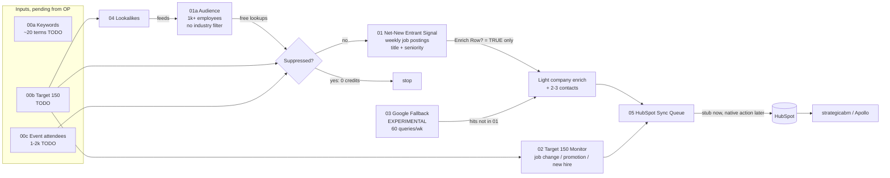

# Optimism (OP) POC: Net-New Entrant Signal Detection in Clay

**The problem:** OP (L2 settlement infrastructure, selling to financial institutions) shows up
late to deals. By the time a company is publicly "doing stablecoins", someone else is already there.

**What the POC proves:** Clay can spot companies entering the blockchain space *before anyone
notices*. Example: Apple posting a "Head of Stablecoin" role last week. Clay surfaces the right
companies and people and pushes them to HubSpot.

**Clay's job in v1:** find signals, identify companies and people, and push to HubSpot. That's all.
Apollo does enrichment and sequencing, HubSpot is the CRM, and strategicabm runs orchestration.
**No messaging or outreach in Clay.**



## What's in the repo

| Path | What it is |
|---|---|
| `docs/BUILD_GUIDE.md` | **Start here.** Table-by-table Clay build: sources, column order, run conditions, table descriptions (with TODO notes) |
| `clay/formulas.md` | Copy-paste Clay formula columns F1–F9: suppression gate, keyword/seniority matcher, enrichment gate, HubSpot payload stub |
| `tables/*.csv` | Import files for every table, with sample rows (`Is Sample = TRUE`, `Sample Source` says LIVE or ILLUSTRATIVE) |
| `config/signal_config.json` | Single source of truth: keywords (tiers, customer vs suggested), seniority, negatives, size thresholds, cadence, Google query matrix |
| `docs/hubspot-field-mapping.md` | Company and contact property mapping, custom `clay_*` properties, dedupe decision |
| `docs/credit-efficiency.md` | Order of the gates, and gated vs. blanket paid-action estimate |
| `docs/open-items.md` | Everything pending from OP, and what placeholder stands in for it |
| `validation/live_sample_2026-09-28.md` | Real Clay data pulled to test the logic: what matched and what it changed |
| `poc/signal_rules.py` | Python version of the matching rules (for testing and offline scoring of 01 vs 03 exports) |

## Table names (as they appear in the Clay workbook)

- `00a – Config: Signal Keywords` · `00b – Target 150 (master)` · `00c – Suppression: Event Attendees`
- `01a – Net-New Entrant Audience (1k+)` (+ view `5k+ comparison`)
- **`01 – Net-New Entrant Signal`** ⭐ · `01c – Triggered Contacts`
- **`02 – Target 150 Monitor`** (`02a – Target 150 Contacts`, `02b – Target 150 Signal Log`)
- **`03 – Google Fallback (experimental)`** (`03a – Query Matrix`, `03b – Results`)
- `04 – Lookalike Expansion (bonus)` · `05 – HubSpot Sync Queue`

## Key design decisions

- **Size only, no industry filter (v1).** 1k+ is the primary audience, and a 5k+ view is staged for comparison. Per OP's ABM consultant, the titles are specific enough. The industry filter is written up as the first tightening lever (BUILD_GUIDE §01).
- **Title + seniority, not keyword alone.** A trigger needs a niche keyword AND a seniority term (Head/Director/VP/Lead) AND no negative term. Tier A keywords (stablecoin, tokenization, digital assets, DLT, on-chain, settlement infrastructure) get High priority. Broad Tier B keywords (blockchain, crypto, web3) get Medium.
- **Match on job title, not headline or description.** The live pull showed headline matching is noisy (see `validation/`).
- **Suppression first and free. Paid steps only on triggered rows.** See `docs/credit-efficiency.md`. With placeholder assumptions: ~1.3k paid actions/week vs ~36k to blanket-enrich the audience.
- **Weekly cadence.** Set in each signal's schedule, with one `lookback_days` value in config.
- **One HubSpot queue.** All components write to table 05, so there's one mapping, one dedupe, and one place to swap the stub for the live integration.
- **Google fallback is query-driven** (site × title pattern, 60 searches/week), so its cost doesn't grow with the audience. It's built to measure incremental coverage and lead time against 01.

## Demo script (5 min)

1. **Pain (30s):** "Companies that already call themselves stablecoin players, like Corpay and MoneyGram, are too late to catch." Show `validation/`.
2. **01 (2 min):** Open `01 – Net-New Entrant Signal`, filter `Signal Hit? = TRUE`. Apple "Head of Stablecoin" is at the top, posted this week, and not on anyone's list. Show the Visa row (Target 150) and the Coinbase row (event attendee): both matched, both suppressed, **0 credits**. Show "Blockchain Engineer" and "Crypto Payments Intern" rejected by the free title rule.
3. **Output (1 min):** Company enrich plus 3 contacts (hiring exec, adjacent leader, exec sponsor) on triggered rows only. Then table 05: the HubSpot payload, mapped field by field.
4. **02 (1 min):** Visa's stablecoin director who started 2026-08. That's real Clay data, a niche new hire at a target account.
5. **03 + 04 (30s):** The experimental Google fallback and its comparison metrics, and lookalikes feeding the audience.

## Checks

```bash
python3 -m unittest -v                  # matching rules, incl. real titles from the live pull
python3 scripts/check_formula_parity.py # the Clay JS formula (F4) and the Python rules agree
python3 scripts/build_tables.py         # rebuild tables/*.csv from config + samples
python3 scripts/estimate_credits.py --help
python3 -m poc.signal_rules "Head of Stablecoin"
```

## Status

Clay can't build the tables from here: the Clay connector searches and enriches, but it doesn't
create workbooks. So this repo is the build kit. Import the CSVs, paste the formulas, and set the
sources and signals as described in `docs/BUILD_GUIDE.md`.
Pending inputs from OP are listed in `docs/open-items.md`.
